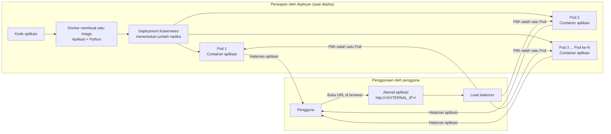
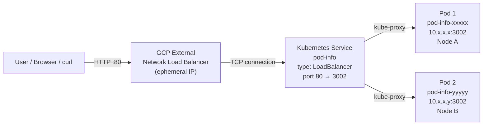

# GKE Load Balancing PoC — Python, 2 Pods, 1 External IP

Proof of Concept (PoC) untuk membuktikan secara **visual** dan **teknis** bahwa satu aplikasi Python dapat berjalan di **dua Pod** sekaligus, dan traffic dari internet terdistribusi ke kedua Pod tersebut melalui **GCP Load Balancer**.

Aplikasi hanya memakai **Python standard library** (tanpa dependency eksternal), berjalan di port **3002**, dan menampilkan **nama Pod**, **IP Pod**, serta **node** yang melayani request secara dinamis.

## Ringkasan

- PoC ini menjalankan aplikasi web Python di Google Kubernetes Engine (GKE). Docker mengemas aplikasi dan Python ke dalam image, lalu Kubernetes menjalankannya di dua Pod dan membagikan traffic melalui satu alamat publik.
- Setelah proses deployment berhasil dan **External IP** tersedia, pengguna cukup membuka URL aplikasi tersebut di browser, misalnya `http://<EXTERNAL_IP>/`. Halaman akan menampilkan informasi Pod yang melayani permintaan.
- Pengguna aplikasi **tidak perlu membuka atau masuk ke container**, membuat virtual environment, memasang Python atau dependency, maupun menjalankan server secara manual. Semua itu sudah disiapkan di image Docker dan dijalankan oleh Kubernetes.
- Perintah Docker, `gcloud`, dan `kubectl` di README ini adalah untuk orang yang menyiapkan, mengelola, atau menguji deployment—bukan langkah yang harus dilakukan setiap kali menggunakan aplikasi.
- Untuk mencoba deployment yang sudah ada, cukup gunakan URL-nya. Untuk membuat deployment baru atau memperbarui aplikasi, ikuti bagian [Langkah Eksekusi & Deployment](#8-langkah-eksekusi--deployment); setelah selesai mencoba, hapus resource cloud sesuai bagian [Cleanup](#12-cleanup) agar biaya tidak terus berjalan.

### Gambaran sederhana



Semua Pod menjalankan container aplikasi dari **image yang sama**. Kubernetes dapat membuat beberapa replika sesuai konfigurasi, dan load balancer mengarahkan pengguna ke salah satu Pod yang siap. Diagram menunjukkan konsep banyak replika; pada PoC ini jumlahnya dikonfigurasi menjadi **dua Pod**. Pengguna cukup membuka URL—tidak perlu masuk ke container atau menyiapkan lingkungan Python sendiri.

Singkatnya: **deployment menyiapkan dan menjalankan aplikasi; pengguna tinggal membuka URL dan memakai aplikasi.**

---

## Daftar Isi

0. [Ringkasan untuk Pemula](#ringkasan-untuk-pemula)
1. [Tujuan PoC](#1-tujuan-poc)
2. [Arsitektur](#2-arsitektur)
3. [Struktur Repository](#3-struktur-repository)
4. [Prasyarat](#4-prasyarat)
5. [Kode Aplikasi](#5-kode-aplikasi)
6. [Dockerfile](#6-dockerfile)
7. [Manifest Kubernetes](#7-manifest-kubernetes)
8. [Langkah Eksekusi & Deployment](#8-langkah-eksekusi--deployment)
9. [Cara Membuktikan (The Proof)](#9-cara-membuktikan-the-proof)
10. [Menjalankan dengan Script](#10-menjalankan-dengan-script)
11. [Troubleshooting](#11-troubleshooting)
12. [Cleanup](#12-cleanup)
13. [Catatan untuk Produksi](#13-catatan-untuk-produksi)

---

## 1. Tujuan PoC

PoC ini dianggap berhasil jika seluruh kriteria berikut terpenuhi:

- [ ] Dua Pod berjalan dengan status `Running` dan `READY 1/1`.
- [ ] Kedua Pod berada di **node yang berbeda**.
- [ ] Service bertipe `LoadBalancer` mendapatkan **External IP** dari GCP.
- [ ] Request ke External IP mencapai **kedua Pod**, terbukti dari nama Pod/IP Pod yang berganti-ganti.
- [ ] Halaman browser menampilkan identitas Pod yang berbeda saat di-refresh.
- [ ] `curl` loop menunjukkan distribusi request ke dua Pod.

> PoC ini membuktikan **load balancing level koneksi TCP (L4)**, bukan load balancing per request HTTP (L7). Penjelasannya ada di bagian [Arsitektur](#2-arsitektur).

---

## 2. Arsitektur



Alur traffic:

1. **User** mengakses `http://<EXTERNAL_IP>/` pada port 80.
2. **GCP External Passthrough Network Load Balancer** menerima koneksi TCP. GKE membuat load balancer ini secara otomatis dari Service `type: LoadBalancer`.
3. **Kubernetes Service** `pod-info` memilih Pod berdasarkan label selector dan meneruskan port 80 ke `targetPort: 3002`.
4. **kube-proxy** di node melakukan DNAT ke salah satu Pod yang siap menerima traffic.
5. Aplikasi Python membaca `POD_NAME`, `POD_IP`, dan `NODE_NAME` dari **Downward API**, lalu mengembalikan HTML/JSON berisi identitas Pod tersebut.

### Penting: L4, bukan L7

`Service type=LoadBalancer` di GKE membuat **Network Load Balancer (L4)**, bukan HTTP(S) Load Balancer. Load balancer memilih backend saat **koneksi TCP dibuat**, bukan untuk setiap request HTTP.

Konsekuensinya, dengan HTTP keep-alive, satu koneksi browser bisa terus diarahkan ke Pod yang sama. Karena itu aplikasi PoC ini mengirim header:

```http
Connection: close
```

Setiap response menutup koneksi, sehingga refresh browser membuka koneksi TCP baru dan load balancer dapat memilih Pod lain. Ini **sengaja dilakukan untuk membuktikan distribusi traffic** dan **bukan praktik terbaik untuk produksi** (keep-alive lebih efisien).

Distribusi GCP LB bersifat **probabilistik (hash 5-tuple)**, bukan strict round-robin. Jadi bisa muncul urutan `Pod A, Pod A, Pod B, Pod A, Pod B, ...`. Yang penting, dalam beberapa request kedua Pod terlihat.

Jika ke depannya membutuhkan routing per request/path/host, TLS termination, atau CDN, gunakan **Ingress/Gateway API + HTTP(S) Load Balancer**, bukan Service `LoadBalancer`.

---

## 3. Struktur Repository

```text
python_k8s_poc/
├── app.py                 # Aplikasi Python (stdlib only)
├── Dockerfile             # Image Python 3.12 Alpine, non-root
├── .dockerignore
├── .gitignore
├── k8s/
│   └── app.yaml           # Deployment (replicas: 2) + Service (LoadBalancer)
├── scripts/
│   ├── deploy.sh          # Siapkan GCP/GKE, build, deploy, dan verifikasi
│   ├── verify.sh          # Bukti otomatis: hit endpoint, hitung Pod unik
│   └── destroy.sh         # Hapus workload + cluster, opsi hapus GAR
└── README.md
```

---

## 4. Prasyarat

| Tool / Resource | Keterangan |
|---|---|
| **Google Cloud project** | Billing aktif. Project ID harus diketahui. |
| **gcloud CLI** | Sudah login: `gcloud auth login`. |
| **kubectl** | Untuk deploy dan inspeksi cluster. |
| **gke-gcloud-auth-plugin** | Biasanya sudah termasuk gcloud terbaru. |
| **Docker** | Build image. Di Apple Silicon wajib build `linux/amd64`. |
| **curl, awk, tr, sed** | Untuk verifikasi di terminal. |
| **watch** (opsional) | Linux biasanya tersedia; macOS: `brew install watch`. |
| **IAM** | Untuk PoC, user butuh akses untuk membuat GKE, Artifact Registry, dan load balancer (mis. `roles/owner` di project percobaan). |
| **Kuota GCP** | Minimal 2 node VM, 1 external IP, dan forwarding rule. |

Versi yang diuji:

```text
Python       3.12
kubectl      v1.37.x (client)
Docker       28.x
GKE          cluster dengan 2 node (zonal)
```

> **Biaya:** PoC ini membuat 2 node GKE dan satu external load balancer. Hapus resource setelah selesai (lihat [Cleanup](#12-cleanup)). Gunakan project percobaan, bukan project produksi.

---

## 5. Kode Aplikasi

Kode lengkap ada di [`app.py`](app.py). Aplikasi sengaja dibuat tanpa Flask/FastAPI agar build cepat, image kecil, dan tidak ada dependency eksternal.

### Endpoint

| Method | Path | Fungsi |
|---|---|---|
| `GET` | `/` | HTML dashboard: nama Pod, IP Pod, node, uptime, request counter. |
| `GET` | `/api/info` | Data identitas Pod dalam format JSON. |
| `GET` | `/healthz` | Liveness probe. |
| `GET` | `/readyz` | Readiness probe (mengembalikan `503` saat shutdown). |
| `GET` | `/favicon.ico` | `204 No Content`. |

### Data dinamis yang ditampilkan

| Field | Sumber |
|---|---|
| `POD_NAME` | Downward API: `metadata.name` |
| `POD_IP` | Downward API: `status.podIP` |
| `NODE_NAME` | Downward API: `spec.nodeName` |
| `POD_NAMESPACE` | Downward API: `metadata.namespace` |
| `APP_VERSION` | Environment variable dari manifest |
| Request counter | Counter in-memory per proses Pod |

Counter dan uptime bersifat **per Pod**, sehingga saat halaman berganti Pod, angka counter juga terlihat berbeda. Ini memperkuat bukti bahwa request benar-benar dilayani proses yang berbeda.

### Response header untuk verifikasi terminal

Setiap response menyertakan header berikut:

```http
X-Pod-Name: pod-info-7c9d8f6b5-2xj7k
X-Pod-IP: 10.52.0.7
X-Node-Name: gke-python-poc-cluster-default-pool-...
X-Pod-Request: 12
```

Header inilah yang dipakai oleh `curl` dan [`scripts/verify.sh`](scripts/verify.sh), sehingga pembuktian tidak bergantung pada parsing HTML.

### Menjalankan aplikasi secara lokal

```bash
python3 app.py
```

Di terminal lain:

```bash
curl -i http://127.0.0.1:3002/
curl -s http://127.0.0.1:3002/api/info | python3 -m json.tool
curl -i http://127.0.0.1:3002/healthz
```

Saat dijalankan di luar Kubernetes, isi `POD_IP` dan `NODE_NAME` akan bernilai `unknown` kecuali di-set manual:

```bash
POD_NAME=local-pod POD_IP=127.0.0.1 NODE_NAME=local-node python3 app.py
```

---

## 6. Dockerfile

Dockerfile menggunakan `python:3.12-alpine` karena aplikasi tidak memiliki dependency compiled. Multi-stage build tidak memberi keuntungan berarti di sini, tetapi image tetap kecil, non-root, dan siap untuk `readOnlyRootFilesystem`.

Poin penting:

- `PYTHONDONTWRITEBYTECODE=1` dan `PYTHONUNBUFFERED=1`.
- User non-root dengan UID/GID `10001`.
- `HEALTHCHECK` untuk penggunaan Docker lokal (Kubernetes memakai probe sendiri).
- `STOPSIGNAL SIGTERM` dan graceful shutdown di aplikasi.
- Hanya `app.py` yang masuk ke image.

Build dan uji image secara lokal:

```bash
docker build --platform linux/amd64 -t pod-info:local .

docker run --rm --read-only \
  --tmpfs /tmp:rw,noexec,nosuid,size=16m \
  -p 3002:3002 \
  -e POD_NAME=local-pod \
  -e POD_IP=127.0.0.1 \
  -e NODE_NAME=local-node \
  pod-info:local
```

Lalu akses `http://127.0.0.1:3002/`.

---

## 7. Manifest Kubernetes

File: [`k8s/app.yaml`](k8s/app.yaml) berisi dua resource:

### Deployment

- `replicas: 2`.
- `image: IMAGE_PLACEHOLDER` — diganti saat deploy.
- Container port `3002` dengan nama `http`.
- **Resource requests/limits**:
  - requests: CPU `100m`, memory `64Mi`
  - limits: CPU `250m`, memory `128Mi`
- **Probes**: startup, readiness, dan liveness.
- **Security context**: non-root, `readOnlyRootFilesystem`, drop semua capability, `seccompProfile: RuntimeDefault`.
- **Topology spread** `whenUnsatisfiable: DoNotSchedule` pada `kubernetes.io/hostname`:
  - Dengan `replicas: 2` dan minimal 2 node, scheduler memaksa satu Pod per node.
  - Ini yang membuat pembuktian “Pod tersebar di node berbeda” menjadi deterministik.
- `automountServiceAccountToken: false` karena aplikasi tidak perlu mengakses Kubernetes API.

### Service

- `type: LoadBalancer` → GKE membuat external passthrough Network Load Balancer dan External IP.
- Port publik `80` → `targetPort: http` (3002).
- `sessionAffinity: None`.
- `externalTrafficPolicy: Cluster` agar semua node bisa menjadi backend load balancer.

> **Port:** container tetap mendengarkan di `3002`; Service memetakan port publik `80` ke `targetPort: http` (3002). Jika ingin mengakses lewat `http://<IP>:3002`, ubah `spec.ports[0].port` pada Service menjadi `3002`.
>
> Jika cluster hanya punya **1 node**, Pod kedua akan `Pending` karena constraint `DoNotSchedule`. Solusinya: tambah node, atau ubah menjadi `whenUnsatisfiable: ScheduleAnyway` (tetapi distribusi antar-node tidak lagi dijamin).

---

## 8. Langkah Eksekusi & Deployment

Semua perintah di bawah dijalankan dari root repository ini.

### 8.1 Set variabel environment

```bash
export PROJECT_ID="$(gcloud config get-value project)"
export REGION="asia-southeast2"          # Jakarta
export ZONE="asia-southeast2-a"
export CLUSTER="python-poc-cluster"
export REPO="python-poc"
export TAG="v1"
export IMAGE="${REGION}-docker.pkg.dev/${PROJECT_ID}/${REPO}/pod-info:${TAG}"

echo "Project : ${PROJECT_ID}"
echo "Region  : ${REGION}"
echo "Zone    : ${ZONE}"
echo "Image   : ${IMAGE}"
```

Pastikan `PROJECT_ID` tidak kosong dan bukan `(unset)`:

```bash
gcloud config get-value project
gcloud auth list --filter=status:ACTIVE --format='value(account)'
```

Jika perlu:

```bash
gcloud config set project YOUR_PROJECT_ID
```

### 8.2 Aktifkan API yang dibutuhkan

```bash
gcloud services enable \
  container.googleapis.com \
  artifactregistry.googleapis.com \
  --project="${PROJECT_ID}"
```

### 8.3 Buat Artifact Registry repository

```bash
gcloud artifacts repositories describe "${REPO}" \
  --location="${REGION}" \
  --project="${PROJECT_ID}" >/dev/null 2>&1 \
|| gcloud artifacts repositories create "${REPO}" \
  --repository-format=docker \
  --location="${REGION}" \
  --description="GKE load balancing PoC images" \
  --project="${PROJECT_ID}"
```

### 8.4 Buat cluster GKE dengan 2 node

```bash
gcloud container clusters create "${CLUSTER}" \
  --zone="${ZONE}" \
  --num-nodes=2 \
  --machine-type=e2-small \
  --disk-size=30 \
  --release-channel=regular \
  --project="${PROJECT_ID}"
```

Ambil kredensial dan pastikan kedua node siap:

```bash
gcloud container clusters get-credentials "${CLUSTER}" \
  --zone="${ZONE}" \
  --project="${PROJECT_ID}"

kubectl get nodes
```

Output yang diharapkan: **2 node** dengan status `Ready`.

> **Izin pull image:** node service account harus dapat membaca repository Artifact Registry. Script deploy menambahkan izin baca hanya pada repository yang digunakan. Untuk membuatnya manual, jalankan:
>
> ```bash
> PROJECT_NUMBER="$(gcloud projects describe "${PROJECT_ID}" --format='value(projectNumber)')"
> gcloud artifacts repositories add-iam-policy-binding "${REPO}" \
>   --location="${REGION}" \
>   --member="serviceAccount:${PROJECT_NUMBER}-compute@developer.gserviceaccount.com" \
>   --role="roles/artifactregistry.reader" \
>   --project="${PROJECT_ID}"
> ```
>
> Jika node pool memakai service account khusus, ganti alamat service account pada perintah dengan service account node pool tersebut.

### 8.5 Build dan push image ke Google Artifact Registry

Login Docker ke GAR:

```bash
gcloud auth configure-docker "${REGION}-docker.pkg.dev" --quiet
```

Build untuk arsitektur node GKE (`linux/amd64`), lalu push:

```bash
docker build --platform linux/amd64 -t "${IMAGE}" .
docker push "${IMAGE}"
```

Verifikasi image sudah masuk registry:

```bash
gcloud artifacts docker images list \
  "${REGION}-docker.pkg.dev/${PROJECT_ID}/${REPO}" \
  --include-tags \
  --limit=5
```

> Di Apple Silicon (M1/M2/M3), flag `--platform linux/amd64` wajib. Tanpa flag tersebut, image bisa berarsitektur `arm64` dan gagal berjalan di node GKE x86_64.
>
> Jika mengubah kode, gunakan tag baru (mis. `TAG="v2"` atau Git SHA) sebelum build dan deploy. Manifest memakai `imagePullPolicy: IfNotPresent`; menimpa tag lama dapat membuat node memakai image yang sudah di-cache.

### 8.6 Deploy ke GKE

Ganti placeholder image langsung saat apply, tanpa perlu mengedit file:

```bash
sed "s|IMAGE_PLACEHOLDER|${IMAGE}|g" k8s/app.yaml | kubectl apply -f -
```

Tunggu rollout selesai:

```bash
kubectl rollout status deployment/pod-info --timeout=180s
kubectl get pods -l app.kubernetes.io/name=pod-info -o wide
```

### 8.7 Dapatkan External IP

```bash
kubectl get service pod-info --watch
```

Tunggu sampai kolom `EXTERNAL-IP` berubah dari `<pending>` menjadi alamat IPv4 (biasanya 1–3 menit). Setelah itu, ambil IP-nya:

```bash
export EXTERNAL_IP="$(kubectl get service pod-info -o jsonpath='{.status.loadBalancer.ingress[0].ip}')"
echo "URL PoC: http://${EXTERNAL_IP}/"
```

Atau gunakan loop sampai IP tersedia:

```bash
export EXTERNAL_IP=""
while [ -z "${EXTERNAL_IP}" ]; do
  sleep 5
  EXTERNAL_IP="$(kubectl get service pod-info -o jsonpath='{.status.loadBalancer.ingress[0].ip}')"
done
echo "URL PoC: http://${EXTERNAL_IP}/"
```

Uji akses:

```bash
curl -i "http://${EXTERNAL_IP}/"
```

---

## 9. Cara Membuktikan (The Proof)

### A. Bukti visual via browser

1. Buka `http://${EXTERNAL_IP}/` di browser.
2. Perhatikan **nama Pod besar** di bagian atas dan **Pod IP** di kartu identitas.
3. Halaman otomatis refresh setiap **5 detik**. Tunggu 10–20 detik, atau lakukan hard refresh:
   - Windows/Linux: `Ctrl + Shift + R` atau `Ctrl + F5`
   - macOS: `Cmd + Shift + R`
4. Nama Pod dan IP Pod harus bergantian, misalnya:

   ```text
   Refresh 1 → pod-info-7c9d8f6b5-2xj7k  |  10.52.0.7  | Node A
   Refresh 2 → pod-info-7c9d8f6b5-9q4mz  |  10.52.1.9  | Node B
   Refresh 3 → pod-info-7c9d8f6b5-2xj7k  |  10.52.0.7  | Node A
   ```

5. Warna aksen kartu juga berubah karena diturunkan secara deterministik dari nama Pod.

> Tidak harus selalu A-B-A-B. Load balancer L4 memakai hash koneksi, sehingga pola bisa A-A-B-A-B. Yang penting kedua Pod muncul dalam beberapa refresh.

**Jika browser terus menampilkan Pod yang sama:**

- Lakukan hard refresh atau buka jendela incognito baru.
- Pastikan akses memakai `http://`, bukan cache.
- Gunakan `curl` (di bawah) sebagai bukti utama; setiap proses `curl` membuka koneksi baru.

### B. Bukti via curl loop (paling deterministik)

Perintah ini mencetak nama Pod dan IP Pod untuk 20 request berurutan:

```bash
for ((i=1; i<=20; i++)); do
  printf 'request %02d -> ' "${i}"
  curl -sS -D - -o /dev/null "http://${EXTERNAL_IP}/" \
    | tr -d '\r' \
    | awk -F': ' '
        tolower($1) == "x-pod-name" { printf "%s ", $2 }
        tolower($1) == "x-pod-ip"   { print "(" $2 ")" }
      '
done
```

Contoh output:

```text
request 01 -> pod-info-7c9d8f6b5-2xj7k (10.52.0.7)
request 02 -> pod-info-7c9d8f6b5-9q4mz (10.52.1.9)
request 03 -> pod-info-7c9d8f6b5-2xj7k (10.52.0.7)
request 04 -> pod-info-7c9d8f6b5-9q4mz (10.52.1.9)
...
```

Hitung distribusinya:

```bash
for ((i=1; i<=30; i++)); do
  curl -sS -D - -o /dev/null "http://${EXTERNAL_IP}/" \
    | tr -d '\r' \
    | awk -F': ' 'tolower($1) == "x-pod-name" { print $2 }'
done | sort | uniq -c
```

Contoh output:

```text
     16 pod-info-7c9d8f6b5-2xj7k
     14 pod-info-7c9d8f6b5-9q4mz
```

Atau jalankan script yang sudah disediakan:

```bash
./scripts/verify.sh
```

Script akan:

- otomatis menemukan External IP dari Service,
- mengirim 30 request (bisa diubah dengan `COUNT=50`),
- menampilkan Pod, Pod IP, dan node per request,
- menghitung jumlah Pod unik,
- menampilkan daftar Pod beserta node,
- exit code `1` jika hanya satu Pod yang tercapai.

### C. Bukti live dengan `watch`

```bash
export EXTERNAL_IP
watch -n 1 'curl -sS -D - -o /dev/null "http://$EXTERNAL_IP/" | tr -d "\r" | grep -i "^X-Pod-Name:"'
```

Setiap detik layar akan menampilkan header `X-Pod-Name` dari Pod yang melayani request. Tekan `Ctrl+C` untuk berhenti.

> macOS tidak menyertakan `watch` secara bawaan. Install dengan `brew install watch`, atau gunakan opsi B.

Alternatif jika `jq` tersedia:

```bash
watch -n 1 'curl -sS "http://$EXTERNAL_IP/api/info" | jq -r ".pod_name + \"  \" + .pod_ip + \"  \" + .node_name"'
```

### D. Bukti bahwa 2 Pod berjalan dan tersebar di node berbeda

Lihat Pod beserta node dan IP-nya:

```bash
kubectl get pods -l app.kubernetes.io/name=pod-info -o wide
```

Output yang diharapkan:

```text
NAME                          READY   STATUS    RESTARTS   AGE   IP          NODE
pod-info-7c9d8f6b5-2xj7k      1/1     Running   0          2m    10.52.0.7   gke-python-poc-cluster-default-pool-a1b2c3d4-x1y2
pod-info-7c9d8f6b5-9q4mz      1/1     Running   0          2m    10.52.1.9   gke-python-poc-cluster-default-pool-e5f6g7h8-z9w0
```

Pastikan kolom `NODE` **berbeda**. Verifikasi lebih ringkas:

```bash
kubectl get pods -l app.kubernetes.io/name=pod-info \
  -o custom-columns='POD:.metadata.name,NODE:.spec.nodeName,POD_IP:.status.podIP,READY:.status.containerStatuses[0].ready'
```

Hitung jumlah node unik:

```bash
kubectl get pods -l app.kubernetes.io/name=pod-info \
  -o jsonpath='{range .items[*]}{.spec.nodeName}{"\n"}{end}' \
  | sort -u | wc -l
```

Nilai yang diharapkan: `2`.

Verifikasi bahwa Service memiliki dua endpoint Pod (bukan hanya satu):

```bash
kubectl get endpoints pod-info
```

Output yang diharapkan kira-kira:

```text
NAME       ENDPOINTS                         AGE
pod-info   10.52.0.7:3002,10.52.1.9:3002    3m
```

Lihat External IP dan port Service:

```bash
kubectl get service pod-info
```

Output yang diharapkan:

```text
NAME       TYPE           CLUSTER-IP     EXTERNAL-IP     PORT(S)        AGE
pod-info   LoadBalancer   10.48.12.34    34.xxx.xxx.xxx  80:31234/TCP   4m
```

Cek event load balancer jika ada masalah:

```bash
kubectl describe service pod-info
```

### E. Checklist bukti akhir

- [ ] `kubectl get pods` → 2 Pod `Running`, `READY 1/1`.
- [ ] Dua Pod berada di dua `NODE` berbeda.
- [ ] `kubectl get endpoints pod-info` → 2 endpoint `:3002`.
- [ ] `kubectl get service pod-info` → `EXTERNAL-IP` bukan `<pending>`.
- [ ] `curl` loop → minimal 2 nama Pod berbeda.
- [ ] Browser refresh → nama Pod dan IP berganti.

---

## 10. Menjalankan dengan Script

Jalankan satu perintah berikut dari root repository. Jika cluster belum ada, script akan membuatnya otomatis:

```bash
PROJECT_ID="your-project-id" \
./scripts/deploy.sh
```

Script akan:
1. mengaktifkan API GKE, Artifact Registry, dan Compute Engine,
2. membuat Artifact Registry repository jika belum ada,
3. membuat cluster GKE zonal 2 node jika belum ada (atau menggunakan cluster yang sudah ada),
4. menunggu minimal 2 node siap dan memberi service account node akses baca ke repository image,
5. build image `linux/amd64` dan push dengan tag unik (timestamp),
6. render `IMAGE_PLACEHOLDER` lalu apply manifest,
7. menunggu rollout dan External IP Load Balancer,
8. menjalankan `scripts/verify.sh`.

Default cluster: `asia-southeast2-a`, 2 node `e2-small`, disk 30 GB. Atur `LOCATION`, `REGION`, `CLUSTER`, `MACHINE_TYPE`, `NUM_NODES` (minimal 2), atau `DISK_SIZE` sesuai kebutuhan. Perintah ini membutuhkan login `gcloud`, billing aktif, dan izin untuk mengaktifkan API, membuat cluster/repository, serta mengubah IAM policy repository Artifact Registry.

> **Biaya:** deploy otomatis dapat membuat VM GKE, disk, dan Load Balancer ber-IP publik. Resource cluster tetap berjalan setelah script selesai dan terus menimbulkan biaya sampai dihapus. Setelah selesai mencoba, jalankan `./scripts/destroy.sh` (Artifact Registry tetap dipertahankan secara default).

Verifikasi ulang kapan saja:

```bash
./scripts/verify.sh                # auto-detect External IP
./scripts/verify.sh http://IP      # URL eksplisit
COUNT=50 ./scripts/verify.sh       # 50 request
```

Untuk menghapus semua resource setelah selesai:

```bash
./scripts/destroy.sh --dry-run     # lihat rencana, tidak menghapus apa pun
./scripts/destroy.sh               # menghapus workload + cluster
./scripts/destroy.sh --yes         # non-interaktif (CI/automation)
./scripts/destroy.sh --yes --delete-repo  # sekaligus hapus GAR (permanen)
```

---

## 11. Troubleshooting

| Gejala | Kemungkinan penyebab | Solusi |
|---|---|---|
| `EXTERNAL-IP` tetap `<pending>` | LB masih provisioning, kuota, atau event error | Tunggu 1–3 menit. Cek `kubectl describe service pod-info` dan `kubectl get events --sort-by=.lastTimestamp`. Pastikan kuota forwarding rule/external IP tersedia. |
| Pod kedua `Pending` | Strict topology spread membutuhkan 2 node | `kubectl get nodes`; tambah node atau ubah `whenUnsatisfiable` menjadi `ScheduleAnyway`. |
| `ImagePullBackOff` / `ErrImagePull` | Path image salah, belum push, atau node tidak punya izin GAR | Cek `kubectl describe pod`. Pastikan image URL persis. Beri node service account `roles/artifactregistry.reader` (lihat 8.4). |
| `kubectl get endpoints` kosong | Label selector tidak cocok, Pod belum Ready, atau port salah | `kubectl get pods --show-labels`; cek readiness probe; pastikan targetPort `http` = 3002. |
| `curl` selalu dapat Pod yang sama | Kebetulan hash, LB cache, atau hanya satu endpoint | Jalankan 30 request. Cek endpoints. Coba hard refresh/incognito. |
| HTTP `503` dari LB | Tidak ada endpoint sehat atau firewall health check | Cek readiness semua Pod; cek firewall jika memakai custom VPC. |
| `watch: command not found` | macOS | `brew install watch`, atau pakai loop `for`. |
| `exec format error` / CrashLoop | Image `arm64` di node amd64 | Build ulang dengan `--platform linux/amd64`, lalu push tag baru. |
| `gcloud`/Docker push `denied` | Belum login atau salah region host | `gcloud auth login`; `gcloud auth configure-docker "${REGION}-docker.pkg.dev"`. |

Debug cepat:

```bash
kubectl get pods -l app.kubernetes.io/name=pod-info -o wide
kubectl describe pod -l app.kubernetes.io/name=pod-info
kubectl logs -l app.kubernetes.io/name=pod-info --tail=100
kubectl get events --sort-by=.lastTimestamp | tail -20
kubectl describe service pod-info
kubectl get endpoints pod-info
```

---

## 12. Cleanup

Gunakan script destroy yang sudah menyertakan konfirmasi dan `--dry-run`:

```bash
# 1. Lihat apa yang akan dihapus (tidak ada perubahan)
./scripts/destroy.sh --dry-run

# 2. Hapus Deployment, Service, load balancer, dan cluster GKE.
#    Artifact Registry dipertahankan agar image tidak hilang tanpa sengaja.
./scripts/destroy.sh

# 3. Opsional: hapus repository Docker REMOTE di Artifact Registry
#    beserta SEMUA image di dalamnya. Tindakan ini permanen.
./scripts/destroy.sh --delete-repo
```

> **Penting:** `--delete-repo` **bukan** menghapus folder working directory dan **bukan** menghapus repository Git. Yang dihapus adalah repository Docker remote di Google Artifact Registry, yaitu `${REGION}-docker.pkg.dev/${PROJECT_ID}/${REPO}` beserta image yang di-push ke sana. Folder `python_k8s_poc/` di laptop tetap utuh; `destroy.sh` tidak memiliki perintah untuk menghapus file lokal.

Script meminta konfirmasi dengan mengetik:

```text
<PROJECT_ID>/<CLUSTER>
```

Untuk automation/CI, gunakan `--yes`:

```bash
./scripts/destroy.sh --yes
./scripts/destroy.sh --yes --delete-repo
```

Urutan yang dilakukan script:

1. menghapus `deployment/pod-info` dan `service/pod-info` agar load balancer dan External IP dilepas,
2. menghapus cluster GKE beserta node VM,
3. menghapus repository Docker remote di Artifact Registry hanya jika `--delete-repo` diberikan.

Environment variable yang bisa disesuaikan:

```bash
PROJECT_ID="your-project-id" \
REGION="asia-southeast2" \
LOCATION="asia-southeast2-a" \
CLUSTER="python-poc-cluster" \
REPO="python-poc" \
NAMESPACE="default" \
./scripts/destroy.sh --dry-run
```

### Cleanup manual (fallback)

Jika tidak ingin memakai script:

```bash
# Lepas load balancer terlebih dahulu
kubectl delete deployment/pod-info service/pod-info --ignore-not-found

# Hapus cluster dan node VM
gcloud container clusters delete "${CLUSTER}" \
  --zone="${ZONE}" \
  --project="${PROJECT_ID}" \
  --quiet

# Opsional: hapus repository beserta semua image
gcloud artifacts repositories delete "${REPO}" \
  --location="${REGION}" \
  --project="${PROJECT_ID}" \
  --quiet
```

> Menghapus cluster GKE **tidak** otomatis menghapus Artifact Registry. Pastikan keduanya dibersihkan agar tidak ada biaya tersisa.

---

## 13. Catatan untuk Produksi

PoC ini dioptimalkan untuk pembuktian, bukan untuk produksi. Sebelum dipakai lebih jauh:

1. **Hapus `Connection: close`** di `app.py` dan gunakan keep-alive untuk efisiensi. Konsekuensinya, load balancing per koneksi tidak lagi terlihat bergantian di browser.
2. **Gunakan L7 load balancing** (Ingress/Gateway API + HTTP(S) LB) jika butuh routing path/host, TLS, CDN, atau WAF.
3. **Gunakan immutable image tag** (mis. Git SHA) atau digest, bukan `v1` yang bisa ditimpa. `imagePullPolicy: IfNotPresent` aman untuk tag immutable.
4. **Jangan publish aplikasi tanpa autentikasi** jika nanti berisi data sensitif. Tambahkan IAP, OAuth proxy, atau auth layer lain.
5. **Terapkan HPA/PDB**, resource limit yang terukur, dan observability (Cloud Logging/Monitoring, Prometheus).
6. **Perketat keamanan**: private GKE, Workload Identity, NetworkPolicy, Binary Authorization, dan IAM least privilege.
7. **Otomatiskan** build–deploy dengan Cloud Build/CI dan GitOps (Argo CD/Flux), bukan perintah manual.
8. **Gunakan Terraform** untuk cluster, node pool, Artifact Registry, dan load balancer agar reproducible.

---

## Referensi

- [GKE: Service load balancers](https://cloud.google.com/kubernetes-engine/docs/concepts/service-load-balancer)
- [Artifact Registry: Push and pull images](https://cloud.google.com/artifact-registry/docs/docker/pushing-and-pulling)
- [Kubernetes: Pod topology spread constraints](https://kubernetes.io/docs/concepts/scheduling-eviction/topology-spread-constraints/)
- [Kubernetes: Downward API](https://kubernetes.io/docs/concepts/workloads/pods/downward-api/)
